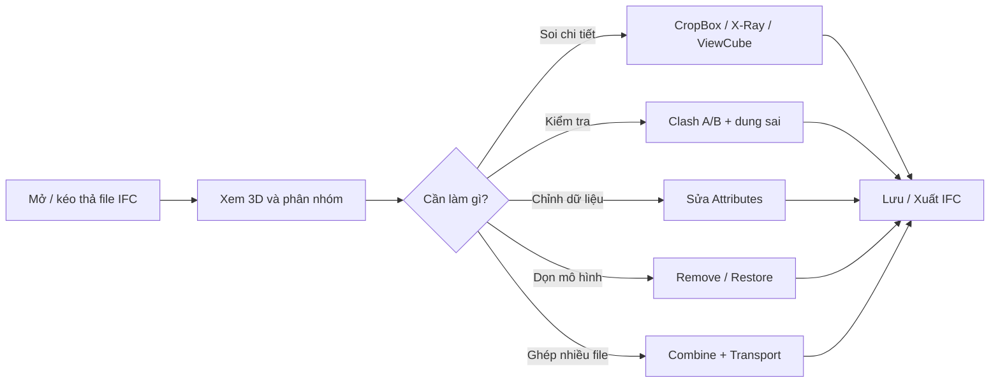
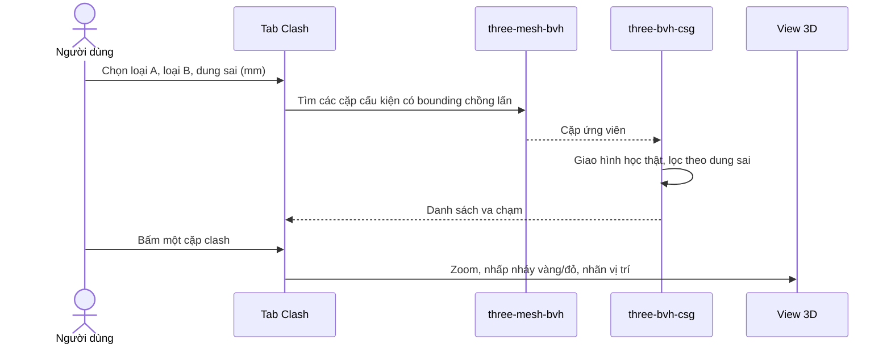
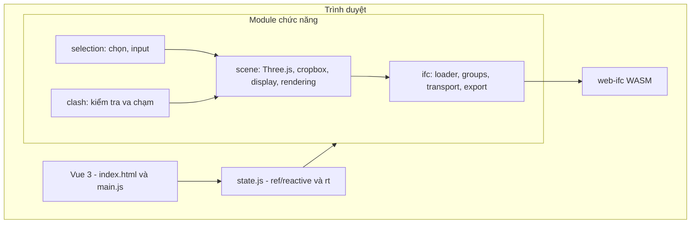

# IFC 3D Rebar & BIM Editor

Ứng dụng web **chạy hoàn toàn trên trình duyệt** để xem, kiểm tra và chỉnh sửa mô hình **IFC** (kết cấu, cốt thép). Không cần cài phần mềm BIM, không gửi file lên máy chủ: dữ liệu IFC được xử lý cục bộ bằng WebAssembly.

> Không chỉ là viewer: đây là công cụ **kiểm tra – chỉnh sửa – chuẩn bị dữ liệu BIM** ngay trên trình duyệt.

## Điểm vượt trội so với viewer IFC thông thường

| Nhóm | Chức năng | Giá trị mang lại |
|---|---|---|
| Xem 3D | Render theo yêu cầu, batch hình học, X-Ray, wireframe, viền cạnh, độ mờ mô hình | Mô hình lớn (hàng chục MB) vẫn mượt |
| Điều hướng | **ViewCube** 26 hướng (6 mặt, 12 cạnh, 8 góc) đồng bộ với camera, trục X/Y/Z, Persp/Ortho | Chuyển hướng nhìn một chạm, nhấp đúp nút giữa để zoom toàn bộ |
| CropBox | Cắt lát 6 mặt độc lập, kéo bằng mũi tên 3D | Soi bên trong cấu kiện, tập trung vùng quan tâm |
| **Clash** | Kiểm tra xung đột giữa các loại cấu kiện (A/B), dung sai mm, zoom tới cặp va chạm | Phát hiện thép đụng thép, thép đụng cột/dầm/sàn |
| Chỉnh sửa | Sửa Name, ObjectType, Tag, Description rồi lưu thành IFC mới | Chuẩn hóa dữ liệu trước khi bàn giao |
| Remove / Restore | Đánh dấu xóa cấu kiện (phím Delete ở mọi tab), khôi phục, xuất IFC đã loại bỏ | Dọn mô hình mà không mất bản gốc |
| Phân nhóm | Theo Pos thép, Name, ObjectType, IFC Type; lọc, ẩn/hiện, chọn cả nhóm | Quản lý hàng nghìn cấu kiện dễ dàng |
| Thép | Tô màu theo đường kính Ø, nhận diện thanh lỗi, lọc chỉ-thép | Đọc bản vẽ thép trực quan |
| Combine | Gộp nhiều file IFC trong cùng một view, mỗi file là một "source" riêng | Ghép mô hình kiến trúc – kết cấu – MEP |
| Transport | Dịch/xoay mô hình theo tọa độ, lưu profile | Căn chỉnh nhiều mô hình về cùng gốc tọa độ |
| Xuất file | Lưu bản chỉnh sửa, xuất phần đang hiển thị, xuất combine | Đúng thứ bạn cần, không thừa dữ liệu |

## Luồng làm việc



## Kiểm tra va chạm (Clash)



## Kiến trúc



## Thao tác nhanh

| Thao tác | Tác dụng |
|---|---|
| Chuột trái | Chọn cấu kiện / xoay view |
| Chuột giữa (kéo) | Pan |
| **Nhấp đúp chuột giữa** | Zoom toàn bộ cấu kiện đang hiển thị |
| Chuột phải | Dịch view |
| Shift + kéo | Chọn theo vùng (kéo sang phải: chọn trọn, sang trái: chọn chạm) |
| Ctrl + click | Chọn thêm / bỏ chọn |
| Delete | Đưa cấu kiện đang chọn vào danh sách xóa (mọi tab) |
| Space | Ẩn / hiện cấu kiện đang chọn |
| C | Bật / tắt CropBox |
| X | Bật / tắt X-Ray |
| Chuột phải vào thuộc tính | Menu Select / Show similar, lọc theo giá trị |

Thanh trạng thái phía dưới còn có thanh **độ mờ mô hình**, nút ☀️/🌚 đổi nền sáng/tối và nút **Persp/Ortho**.

## Chạy dự án

```bash
npm install
npm run dev      # http://localhost:5173
npm run build    # build production vào dist/
```

> Không mở `index.html` trực tiếp bằng `file://` vì module ES bị trình duyệt chặn. Cần internet để tải Tailwind, icon Phosphor, font Inter và WASM web-ifc từ CDN.

## Công nghệ

Vite · Vue 3 · Three.js 0.160 · web-ifc 0.0.66 · three-mesh-bvh · three-bvh-csg · Tailwind CSS (CDN)

## Hướng phát triển

- Xoay CropBox
- Hệ thống đo đạc, dim trong IFC
- Restore all trong mục Remove
- Thông tin khối lượng và các công cụ QC chuyên biệt
