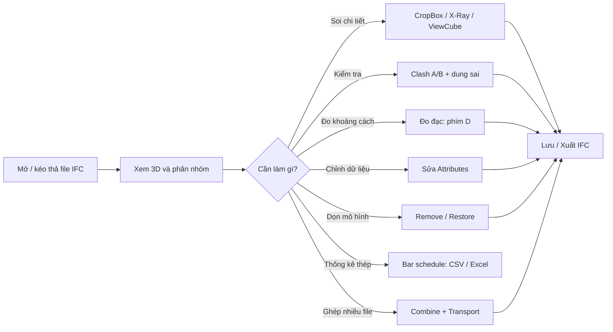
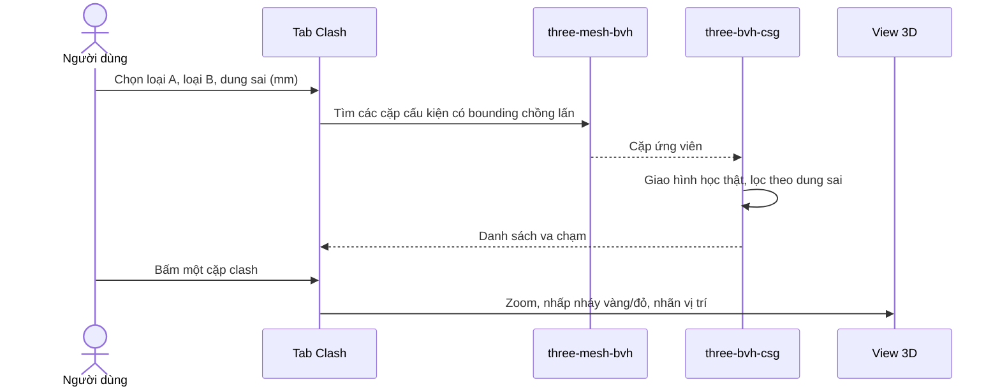
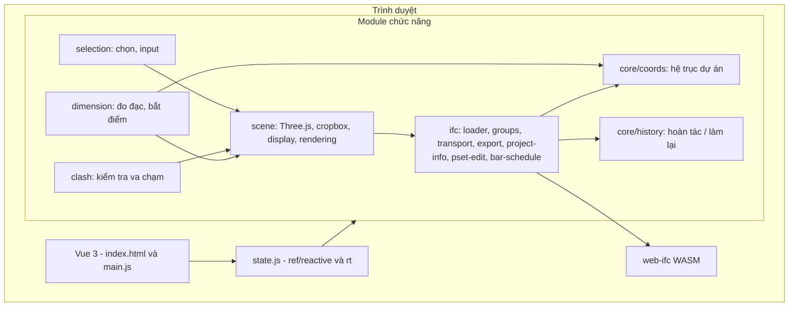

# IFC 3D Rebar & BIM Editor

Ứng dụng web **chạy hoàn toàn trên trình duyệt** để xem, kiểm tra và chỉnh sửa mô hình **IFC** (kết cấu, cốt thép). Không cần cài phần mềm BIM, không gửi file lên máy chủ: dữ liệu IFC được xử lý cục bộ bằng WebAssembly.

> Không chỉ là viewer: đây là công cụ **kiểm tra – chỉnh sửa – chuẩn bị dữ liệu BIM** ngay trên trình duyệt.

## Điểm vượt trội so với viewer IFC thông thường

| Nhóm | Chức năng | Giá trị mang lại |
|---|---|---|
| Xem 3D | Render theo yêu cầu, batch hình học, X-Ray, wireframe, viền cạnh (thanh kéo góc nếp gấp, mặc định 8° để thấy cả chỗ đổi dốc sàn), độ mờ mô hình; **tô màu model theo nhóm** (chuột phải tiêu đề tab Pos / Name / ObjType / IFC Type) | Mô hình lớn (hàng chục MB) vẫn mượt, phân biệt nhóm bằng màu |
| Điều hướng | **ViewCube** 26 hướng (6 mặt, 12 cạnh, 8 góc) ở góc trên trái view, đồng bộ với camera, trục X/Y/Z (Z hướng lên), Persp/Ortho | Chuyển hướng nhìn một chạm, nhấp đúp nút giữa để zoom toàn bộ |
| CropBox | Cắt lát 6 mặt độc lập, kéo bằng mũi tên 3D | Soi bên trong cấu kiện, tập trung vùng quan tâm |
| **Đo đạc** | Đo khoảng cách 2 điểm (phím D), tự bắt điểm vào cạnh, góc giao, vuông góc với cạnh / bề mặt, gợi ý trước vị trí điểm vuông góc, tọa độ điểm theo hệ dự án | Đo nhanh trên model, kể cả đường giao giữa các cấu kiện |
| **Clash** | Kiểm tra xung đột giữa các loại cấu kiện (A/B), dung sai mm, zoom tới cặp va chạm | Phát hiện thép đụng thép, thép đụng cột/dầm/sàn |
| Chỉnh sửa | Sửa Name, ObjectType, Tag, Description; **sửa giá trị thuộc tính Pset** (chuột phải > Sửa giá trị) cho các cấu kiện đang chọn; lưu thành IFC mới | Chuẩn hóa dữ liệu trước khi bàn giao |
| **Thông tin dự án** | Mở file là panel phải hiện header file, IfcProject, IfcSite, IfcBuilding, IfcBuildingStorey, người / tổ chức / ứng dụng xuất IFC, địa chỉ; sửa được và lưu vào IFC mới | Chuẩn hóa tên dự án, tòa, khu, tác giả trước khi bàn giao |
| Remove / Restore | Đánh dấu xóa cấu kiện (phím Delete ở mọi tab), khôi phục, xuất IFC đã loại bỏ | Dọn mô hình mà không mất bản gốc |
| **Hoàn tác / Làm lại** | Ctrl+Z / Ctrl+Y (hoặc nút ↶ ↷ trên header) cho sửa attribute, sửa Pset, transport, thông tin dự án, đánh dấu xóa / khôi phục | Sửa nhầm không phải mở lại file |
| **Thống kê thép** (tạm ẩn) | Tab Thống kê: gom thép theo Pos + Ø, số lượng, chiều dài 1 thanh, tổng chiều dài, khối lượng (kg), tổng theo đường kính; xuất CSV / Excel; click hàng để chọn và zoom | Bảng thống kê thép (bar schedule) ngay từ IFC |
| Phân nhóm | Theo Pos thép, Name, ObjectType, IFC Type; lọc, ẩn/hiện, chọn cả nhóm | Quản lý hàng nghìn cấu kiện dễ dàng |
| Thép | Tô màu theo đường kính Ø, nhận diện thanh lỗi, lọc chỉ-thép | Đọc bản vẽ thép trực quan |
| Tọa độ | Panel thuộc tính và panel thông tin dự án hiện tọa độ tâm/min/max theo hệ dự án (X, Y, Z-up, mét) | Kiểm tra vị trí cấu kiện, mô hình sau khi dịch chuyển |
| Combine | Gộp nhiều file IFC trong cùng một view, mỗi file là một "source" riêng | Ghép mô hình kiến trúc – kết cấu – MEP |
| Transport | Xoay quanh Z rồi dịch theo vector cho **các file đang mở**, lưu vào IFC xuất ra, lưu profile | Đưa mô hình thép từ gốc 0,0,0 về tọa độ công trường rồi mở thêm model công trường để đối chiếu |
| Chia tách / Xuất file | Lưu bản chỉnh sửa, **chia tách** (tab Chia tách: xuất riêng phần đang hiển thị), xuất combine | Đúng thứ bạn cần, không thừa dữ liệu |

## Luồng làm việc



## Kiểm tra va chạm (Clash)



## Thông tin dự án

Ngay khi nạp xong một file IFC, panel phải tự mở và hiển thị **thông tin cấp dự án** của file đó (chưa chọn cấu kiện nào). Các nhóm thông tin, mỗi nhóm là một thẻ thu gọn được:

| Nhóm | Nội dung sửa được |
|---|---|
| Header file | name, time_stamp, author, organization, preprocessor_version, originating_system, authorization, description, implementation_level (schema chỉ đọc) |
| IfcProject / IfcSite / IfcBuilding / IfcBuildingStorey | Name, LongName, Description, ObjectType, Phase, vĩ độ / kinh độ, các cao độ (GlobalId chỉ đọc) |
| Địa chỉ | AddressLines, Town, Region, PostalCode, Country... (nếu site / tòa có địa chỉ) |
| Người, tổ chức, ứng dụng xuất IFC | IfcPerson, IfcOrganization, IfcApplication lấy từ OwnerHistory |

Sửa xong bấm **Áp dụng vào IFC** (ghi vào mô hình đang mở), rồi bấm **Lưu file IFC** trên header để tạo file mới. Panel cũng hiện tọa độ bao (tâm, min, max) của cả file theo hệ dự án. Mở nhiều file thì chọn file ở ô trên cùng của panel. Chọn một cấu kiện thì panel chuyển sang thuộc tính cấu kiện; bấm nút panel ở header để mở lại thông tin dự án.

Lưu ý: dấu nháy đơn và gạch chéo ngược trong giá trị sửa được thay bằng ’ và / vì web-ifc làm hỏng các ký tự này khi lưu.

## Hệ trục tọa độ

Mọi tọa độ hiển thị và nhập trong web (điểm đo, tọa độ cấu kiện, kích thước bao, ô Transport) theo **hệ xây dựng của dự án IFC**: X sang phải, Y đi vào trong, **Z hướng lên trời**, đúng hệ trục vẽ trên View Cube. Tọa độ là tọa độ dự án (không phải tọa độ view đã căn giữa), đơn vị mét (ô Transport nhập cm).

## Sửa giá trị thuộc tính Pset

Chọn một hoặc nhiều cấu kiện, chuột phải vào một thuộc tính trong khung **Property Sets** > **Sửa giá trị**, nhập giá trị mới (giữ đúng kiểu: văn bản, số, số nguyên, đúng/sai) rồi **Áp dụng**.

- Chỉ các cấu kiện đang chọn có thuộc tính đó bị đổi. Pset dùng chung với cấu kiện khác được tách bản sao, nên cấu kiện không chọn giữ giá trị cũ.
- Giá trị mới cập nhật ở panel thuộc tính, chọn/hiện tương tự, lọc, nhóm Pos và màu thép (nếu thuộc tính là Pos/đường kính), và tăng bộ đếm của nút **Lưu file IFC**.
- Chỉ sửa được thuộc tính đơn giá trị (IfcPropertySingleValue) đang có giá trị.

## Hoàn tác / Làm lại

Mỗi thao tác ghi vào IFC là một lệnh trong stack: sửa attribute, sửa giá trị Pset (kể cả khi phải tách bản sao pset), một lượt transport, áp dụng thông tin dự án, đánh dấu xóa / khôi phục cấu kiện. **Ctrl+Z** hoàn tác, **Ctrl+Y** hoặc **Ctrl+Shift+Z** làm lại; nút ↶ ↷ cạnh nút Lưu file IFC hiện tên thao tác khi rê chuột. Số trên nút Lưu là số thao tác khác với lần lưu gần nhất, hoàn tác về đúng bản đã lưu thì nút tắt. Ẩn/hiện, chọn, CropBox, đo đạc không nằm trong stack. Mở file thay thế hoặc đóng một file thì lịch sử được xóa (giữ tối đa 200 thao tác).

## Thống kê thép (Bar schedule)

> Tab này đang tạm ẩn vì kết quả chưa chính xác.

Tab **Thống kê** gom các thanh thép (không tính thanh trong danh sách xóa) theo **Pos + Ø**, tùy chọn chỉ tính thép đang hiện và tách theo file. Mỗi hàng: số lượng, chiều dài 1 thanh (cùng Pos mà dài khác nhau thì hiện khoảng min–max màu vàng), tổng chiều dài, khối lượng; cuối bảng là tổng theo đường kính và tổng chung.

- Chiều dài lấy từ thuộc tính `BarLength` của `IfcReinforcingBar` (đổi theo đơn vị của file); thiếu thì tính từ hình học (dấu ≈): thanh thép là ống kín nên từ thể tích và diện tích bề mặt suy ra được chiều dài đường tim, đúng cả với thanh uốn.
- Khối lượng = L (m) × Ø² (mm) × 0,00617 kg/m (thép 7850 kg/m³), Ø là đường kính danh định nhận lúc nạp file.
- Xuất **CSV** (UTF-8, dấu phẩy) hoặc **Excel** (.xls dạng XML, 2 sheet: chi tiết và theo đường kính; Excel có thể hỏi xác nhận định dạng khi mở).

## Transport (dịch chuyển)

- Áp cho **các file IFC đang mở lúc bấm**; file mở thêm sau đó giữ nguyên vị trí, nên có thể đưa mô hình thép về tọa độ công trường rồi mở model công trường để đối chiếu.
- Thứ tự cố định: **xoay quanh trục Z qua tâm xoay trước, sau đó dịch theo vector**. Tâm và vector nhập theo hệ dự án (cm), góc theo độ (dương là theo chiều kim đồng hồ).
- Mỗi lượt dịch chuyển tăng bộ đếm thay đổi; **Lưu file IFC** ghi vị trí mới vào file xuất. Có hoàn tác lượt mới nhất và lưu/nhập profile (có sẵn profile mẫu "Allplan 👉🏻 S21").

## Đo đạc (Dimension)

Bấm **D** (không kích hoạt khi đang gõ trong ô nhập) để bật/tắt chế độ đo; tab **Đo đạc** ở panel trái liệt kê các phép đo.

- Click chuột trái để chọn điểm 1, click lần 2 để chọn điểm 2. Có đường nối cùng nhãn khoảng cách (cm; từ 1 m trở lên hiển thị m) và 2 quả cầu tự giữ cỡ khi zoom. Esc hủy điểm 1.
- Sau khi chọn điểm 1, đường nối và nhãn chạy theo chuột (xem trước). Rê lên một mặt thì vùng tròn gợi ý hiện sẵn tại chân đường vuông góc; rê lên một cạnh thì ô vuông nhỏ gợi ý điểm vuông góc trên cạnh đó. Đưa chuột vào gợi ý (7px) mới bắt điểm.
- Danh sách đo hiện tọa độ P1, P2 theo hệ dự án.
- Khi hover, điểm pick tự **bắt điểm** trong 7px màn hình (quả cầu xanh đậm, cạnh được bắt tô vàng, dày gấp đôi), theo thứ tự ưu tiên:

| Ưu tiên | Kiểu bắt | Dấu hiệu |
|---|---|---|
| 1 | Vuông góc với cạnh (từ điểm 1 xuống cạnh) | Dấu vuông ở góc phải trên con trỏ; nhóm đo hiện 2 hình vuông |
| 2 | Góc giao của 2 cạnh trở lên | Các cạnh đi qua góc cùng tô vàng |
| 3 | Vuông góc tới bề mặt (kể cả mặt đối diện của cùng cấu kiện) | Vùng tròn vàng trên mặt, dấu tam giác; nhóm đo hiện 2 hình tam giác |
| 4 | Điểm gần nhất trên cạnh | Cạnh tô vàng |
| 5 | Điểm trên bề mặt | Quả cầu trắng |

- Cạnh bắt điểm gồm viền cứng của cấu kiện và **đường giao giữa các cấu kiện** (tính nền, cũng hiển thị như viền khi bật Viền mép). Độ nhạy bắt cạnh chỉnh bằng thanh kéo "Bắt cạnh khi đo" ở tab Hiển thị (góc gấp tối thiểu, mặc định 8°).
- Ra ngoài không trung, vùng đối tượng ẩn hoặc bị CropBox cắt: cursor bàn tay, không bắt điểm.
- Bấm D lần nữa: ẩn toàn bộ hiển thị đo nhưng giữ danh sách. Bấm nhóm đo để zoom tới khoảng đo, nút ✕ để xóa.

Thanh trạng thái đổi chữ và màu nút tròn theo chế độ: Sẵn sàng (xanh lá), Chế độ đo đạc (đỏ), Đang kiểm tra / Chế độ kết quả va chạm (xanh dương). Màu nền sáng/tối và độ mờ mô hình được lưu trong trình duyệt.

## Kiến trúc



## Thao tác nhanh

| Thao tác | Tác dụng |
|---|---|
| Chuột trái | Chọn cấu kiện / xoay view (click trúng mesh thì xoay quanh điểm đó) |
| Chuột giữa (kéo) | Pan |
| **Nhấp đúp chuột giữa** | Zoom toàn bộ cấu kiện đang hiển thị |
| Chuột phải | Dịch view |
| Shift + kéo | Chọn theo vùng theo hình thật của cấu kiện (kéo sang phải: chọn cấu kiện nằm trọn, sang trái: chọn cấu kiện chạm vùng) |
| Ctrl + click | Chọn thêm / bỏ chọn |
| Delete | Đưa cấu kiện đang chọn vào danh sách xóa (mọi tab) |
| Space | Ẩn / hiện cấu kiện đang chọn |
| C | Bật / tắt CropBox |
| D | Bật / tắt chế độ đo đạc |
| X | Bật / tắt X-Ray |
| Ctrl + Z / Ctrl + Y | Hoàn tác / làm lại thao tác ghi IFC (Ctrl + Shift + Z cũng là làm lại) |
| Chuột phải vào thuộc tính | Menu Sửa giá trị (thuộc tính Pset), Chọn / Chỉ hiện tương tự, lọc theo giá trị |

Thanh trạng thái phía dưới còn có thanh **độ mờ mô hình**, nút ☀️/🌚 đổi nền sáng/tối và nút **Persp/Ortho**.

## Chạy dự án

```bash
npm install
npm run dev      # http://localhost:5173
npm run build    # build production vào dist/
```

> Không mở `index.html` trực tiếp bằng `file://` vì module ES bị trình duyệt chặn. Cần internet để tải Tailwind, icon Phosphor, font Inter và WASM web-ifc từ CDN.

## Công nghệ

Vite · Vue 3 · Three.js 0.160 · web-ifc 0.0.66 · three-mesh-bvh · three-bvh-csg · Tailwind CSS (CDN)

## Hướng phát triển

- Xoay CropBox
- Đo đạc nâng cao: bắt đỉnh, ghi dim vào IFC
- Restore all trong mục Remove
- Đọc/sửa Pset gắn qua kiểu cấu kiện (IfcTypeObject)
- Thông tin khối lượng và các công cụ QC chuyên biệt
