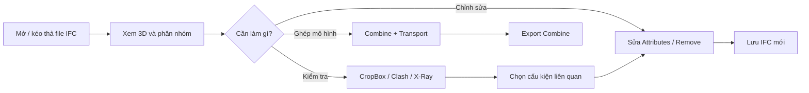
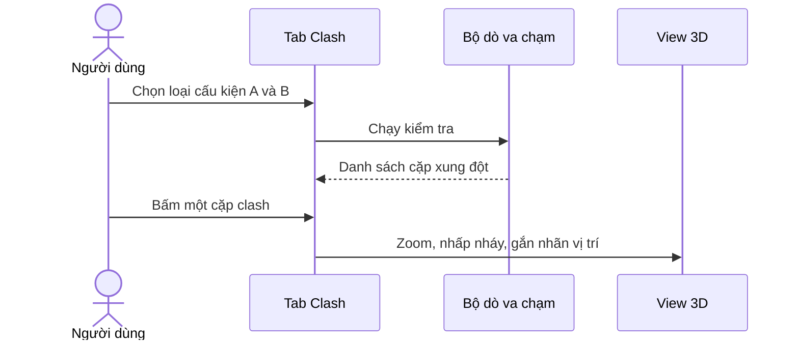
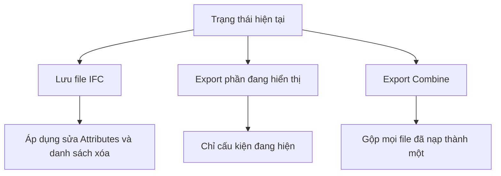
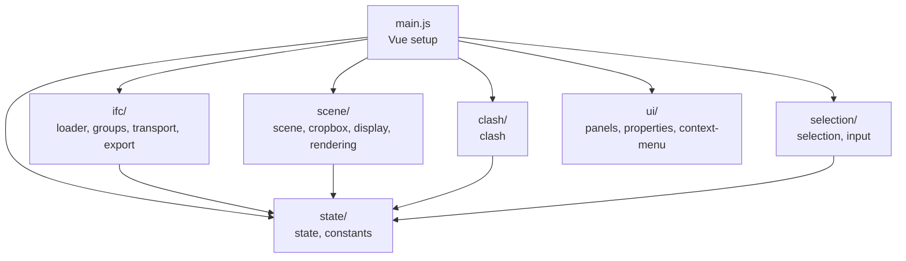

# IFC 3D Rebar & BIM Editor

Ứng dụng một trang, chạy hoàn toàn trên trình duyệt, để **xem, kiểm tra và chỉnh sửa mô hình thép (rebar) và BIM dạng IFC**. Không cần máy chủ: file IFC được đọc và xử lý ngay trên máy của bạn.

> Công nghệ: Vite · Vue 3 · Three.js · web-ifc (WASM) · three-mesh-bvh · three-bvh-csg

## Điểm khác biệt so với viewer IFC thông thường

| Nhóm | Chức năng đặc biệt |
|---|---|
| Xem | Thép tự phân màu theo đường kính Ø, ViewCube đồng bộ camera, X-Ray, wireframe, Perspective/Ortho |
| Kiểm tra | **Clash** (va chạm/xung đột) giữa các cấu kiện, **CropBox 6 mặt** độc lập |
| Chỉnh sửa | Sửa Name, ObjectType, Tag, Description; đánh dấu **Remove/Restore** cấu kiện |
| Nhiều file | **Combine** nhiều IFC trong cùng một view, **Transport** dịch/xoay tọa độ |
| Xuất | Lưu IFC đã chỉnh sửa, xuất phần đang hiển thị, xuất bản gộp |

## Luồng làm việc



## Chức năng chính

### 1. Xem mô hình 3D chuyên sâu
- Thép được **tô màu theo đường kính (Phi Ø)**, cấu kiện khác tô theo loại IFC.
- **ViewCube** ở góc phải trên: khối cubic xoay đồng bộ với camera, kèm trục X/Y/Z. Bấm vào **6 mặt, 12 cạnh hoặc 8 góc** để đổi hướng nhìn (26 hướng).
- Chuyển **Perspective / Orthographic** bằng nút ngay trên thanh trạng thái.
- Thanh trạng thái còn có thanh **độ mờ toàn bộ mô hình** và nút đổi **nền sáng / tối**.
- X-Ray, wireframe, viền cấu kiện, lọc thép lỗi, chỉ hiện thép.

### 2. CropBox 6 mặt độc lập
Cắt mô hình bằng hộp có **6 mũi tên điều khiển độc lập**, mỗi mũi tên kéo một mặt. Mũi tên luôn nổi trên mô hình, kể cả khi bật X-Ray.

### 3. Kiểm tra xung đột (Clash)
Tìm va chạm giữa hai tập cấu kiện (chọn loại A và B), dựa trên hình học thực (CSG). Bấm một cặp clash để zoom tới vị trí; khối được chọn nhấp nháy rồi giữ màu nổi bật, kèm nhãn chỉ vị trí.



### 4. Chỉnh sửa và quản lý cấu kiện
- Sửa **Name, ObjectType, Tag, Description**, xem toàn bộ Attributes và Property Sets.
- **Chuột phải vào một thuộc tính** để: *Select similar*, *Show similar* hoặc *Filter with attribute*.
- **Remove / Restore**: đưa cấu kiện vào danh sách xóa (bấm Delete ở bất kỳ tab nào), khôi phục lại khi cần. Cấu kiện đã xóa bị mờ và không chọn được trong danh sách nhóm.
- **Phân nhóm** theo Pos thép, Tên, ObjectType hoặc IFC Type; hiện/ẩn từng nhóm.

### 5. Nhiều file IFC cùng lúc
- **Combine**: thêm nhiều file (kể cả kéo thả), mỗi file là một nguồn có trạng thái hiển thị và xóa riêng.
- **Transport**: dịch và xoay mô hình theo bộ tọa độ, lưu thành profile, hoàn tác từng lần.

### 6. Xuất và lưu file



## Thao tác nhanh

| Thao tác | Kết quả |
|---|---|
| Chuột trái | Chọn cấu kiện (Ctrl để chọn thêm) |
| Chuột trái kéo | Xoay camera |
| Chuột giữa kéo | Pan |
| Nhấp đúp chuột giữa | Zoom toàn bộ cấu kiện đang hiển thị |
| Shift + kéo | Chọn theo vùng (kéo trái sang phải: nằm trọn; phải sang trái: chạm vùng) |
| `Delete` | Đánh dấu xóa các cấu kiện đang chọn |
| `Space` | Ẩn/hiện cấu kiện đang chọn |
| `C` | Bật/tắt CropBox |
| `X` | Bật/tắt X-Ray |
| Chuột phải vào thuộc tính | Mở menu Select/Show/Filter |
| `Esc` | Đóng menu ngữ cảnh |

## Chạy dự án

Cần Node.js. Không mở `index.html` trực tiếp bằng `file://` vì module ES bị trình duyệt chặn.

```bash
npm install
npm run dev     # http://localhost:5173
npm run build   # build production vào dist/
```

Lưu ý: Tailwind, icon Phosphor, font Inter và WASM của web-ifc tải từ CDN nên cần internet khi chạy.

## Cấu trúc mã nguồn



- Mỗi cấu kiện được khóa theo `sourceId:expressID` để nhiều file IFC cùng tồn tại.
- Render theo yêu cầu (`requestRender`), không dùng vòng lặp vẽ liên tục.
- Chi tiết kiến trúc: xem [CLAUDE.md](CLAUDE.md).

## Hướng phát triển
- Xoay CropBox
- Hệ thống đo đạc, dim trong IFC
- Restore all trong mục Remove
