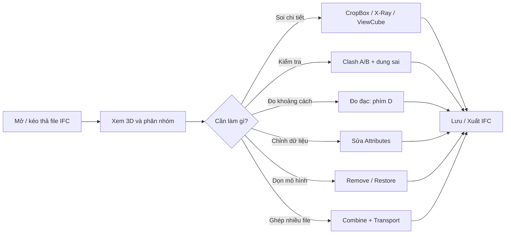
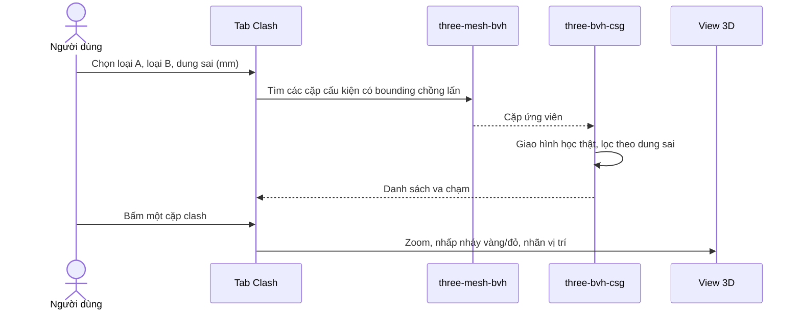
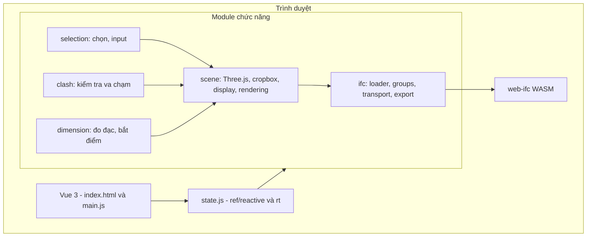

# IFC 3D Rebar & BIM Editor

Ứng dụng web **chạy hoàn toàn trên trình duyệt** để xem, kiểm tra và chỉnh sửa mô hình **IFC** (kết cấu, cốt thép). Không cần cài phần mềm BIM, không gửi file lên máy chủ: dữ liệu IFC được xử lý cục bộ bằng WebAssembly.

> Không chỉ là viewer: đây là công cụ **kiểm tra – chỉnh sửa – chuẩn bị dữ liệu BIM** ngay trên trình duyệt.

## Điểm vượt trội so với viewer IFC thông thường

| Nhóm | Chức năng | Giá trị mang lại |
|---|---|---|
| Xem 3D | Render theo yêu cầu, batch hình học, X-Ray, wireframe, viền cạnh, độ mờ mô hình | Mô hình lớn (hàng chục MB) vẫn mượt |
| Điều hướng | **ViewCube** 26 hướng (6 mặt, 12 cạnh, 8 góc) đồng bộ với camera, trục X/Y/Z, Persp/Ortho | Chuyển hướng nhìn một chạm, nhấp đúp nút giữa để zoom toàn bộ |
| CropBox | Cắt lát 6 mặt độc lập, kéo bằng mũi tên 3D | Soi bên trong cấu kiện, tập trung vùng quan tâm |
| **Đo đạc** | Đo khoảng cách 2 điểm (phím D), tự bắt điểm vào cạnh, góc giao, vuông góc với cạnh / bề mặt, xem trước khi di chuột | Đo nhanh trên model, kể cả đường giao giữa các cấu kiện |
| **Clash** | Kiểm tra xung đột giữa các loại cấu kiện (A/B), dung sai mm, zoom tới cặp va chạm | Phát hiện thép đụng thép, thép đụng cột/dầm/sàn |
| Chỉnh sửa | Sửa Name, ObjectType, Tag, Description rồi lưu thành IFC mới | Chuẩn hóa dữ liệu trước khi bàn giao |
| **Thông tin dự án** | Mở file là panel phải hiện header file, IfcProject, IfcSite, IfcBuilding, IfcBuildingStorey, người / tổ chức / ứng dụng xuất IFC, địa chỉ; sửa được và lưu vào IFC mới | Chuẩn hóa tên dự án, tòa, khu, tác giả trước khi bàn giao |
| Remove / Restore | Đánh dấu xóa cấu kiện (phím Delete ở mọi tab), khôi phục, xuất IFC đã loại bỏ | Dọn mô hình mà không mất bản gốc |
| Phân nhóm | Theo Pos thép, Name, ObjectType, IFC Type; lọc, ẩn/hiện, chọn cả nhóm | Quản lý hàng nghìn cấu kiện dễ dàng |
| Thép | Tô màu theo đường kính Ø, nhận diện thanh lỗi, lọc chỉ-thép | Đọc bản vẽ thép trực quan |
| Combine | Gộp nhiều file IFC trong cùng một view, mỗi file là một "source" riêng | Ghép mô hình kiến trúc – kết cấu – MEP |
| Transport | Dịch/xoay mô hình theo tọa độ, lưu profile | Căn chỉnh nhiều mô hình về cùng gốc tọa độ |
| Chia tách / Xuất file | Lưu bản chỉnh sửa, **chia tách** (tab Chia tách: xuất riêng phần đang hiển thị), xuất combine | Đúng thứ bạn cần, không thừa dữ liệu |

## Luồng làm việc



## Kiểm tra va chạm (Clash)



## Thông tin dự án

Ngay khi nạp xong một file IFC, panel phải tự mở và hiển thị **thông tin cấp dự án** của file đó (chưa chọn cấu kiện nào). Các nhóm thông tin, mỗi nhóm là một thẻ thu gọn được:

| Nhóm | Nội dung sửa được |
|---|---|
| Header file | name, time_stamp, author, organization, preprocessor_version, originating_system, authorization, description, implementation_level (schema chỉ đọc) |
| IfcProject / IfcSite / IfcBuilding / IfcBuildingStorey | Name, LongName, Description, ObjectType, Phase, vĩ độ / kinh độ, các cao độ (GlobalId chỉ đọc) |
| Địa chỉ | AddressLines, Town, Region, PostalCode, Country... (nếu site / tòa có địa chỉ) |
| Người, tổ chức, ứng dụng xuất IFC | IfcPerson, IfcOrganization, IfcApplication lấy từ OwnerHistory |

Sửa xong bấm **Áp dụng vào IFC** (ghi vào mô hình đang mở), rồi **Lưu file IFC** để tạo file mới. Mở nhiều file thì chọn file ở ô trên cùng của panel. Chọn một cấu kiện thì panel chuyển sang thuộc tính cấu kiện; bấm nút panel ở header để mở lại thông tin dự án.

Lưu ý: dấu nháy đơn và gạch chéo ngược trong giá trị sửa được thay bằng ’ và / vì web-ifc làm hỏng các ký tự này khi lưu.

## Đo đạc (Dimension)

Bấm **D** (không kích hoạt khi đang gõ trong ô nhập) để bật/tắt chế độ đo; tab **Đo đạc** ở panel trái liệt kê các phép đo.

- Click chuột trái để chọn điểm 1, click lần 2 để chọn điểm 2. Có đường nối cùng nhãn khoảng cách (cm; từ 1 m trở lên hiển thị m) và 2 quả cầu tự giữ cỡ khi zoom. Esc hủy điểm 1.
- Sau khi chọn điểm 1, đường nối và nhãn chạy theo chuột (xem trước).
- Khi hover, điểm pick tự **bắt điểm** trong 7px màn hình (quả cầu xanh đậm, cạnh được bắt tô vàng, dày gấp đôi), theo thứ tự ưu tiên:

| Ưu tiên | Kiểu bắt | Dấu hiệu |
|---|---|---|
| 1 | Vuông góc với cạnh (từ điểm 1 xuống cạnh) | Dấu vuông ở góc phải trên con trỏ; nhóm đo hiện 2 hình vuông |
| 2 | Góc giao của 2 cạnh trở lên | Các cạnh đi qua góc cùng tô vàng |
| 3 | Vuông góc tới bề mặt (kể cả mặt đối diện của cùng cấu kiện) | Vùng tròn vàng trên mặt, dấu tam giác; nhóm đo hiện 2 hình tam giác |
| 4 | Điểm gần nhất trên cạnh | Cạnh tô vàng |
| 5 | Điểm trên bề mặt | Quả cầu trắng |

- Cạnh bắt điểm gồm viền cứng của cấu kiện và **đường giao giữa các cấu kiện** (tính nền, cũng hiển thị như viền khi bật Viền mép).
- Ra ngoài không trung, vùng đối tượng ẩn hoặc bị CropBox cắt: cursor bàn tay, không bắt điểm.
- Bấm D lần nữa: ẩn toàn bộ hiển thị đo nhưng giữ danh sách. Bấm nhóm đo để zoom tới khoảng đo, nút ✕ để xóa.

Thanh trạng thái đổi chữ và màu nút tròn theo chế độ: Sẵn sàng (xanh lá), Chế độ đo đạc (đỏ), Đang kiểm tra / Chế độ kết quả va chạm (xanh dương). Màu nền sáng/tối và độ mờ mô hình được lưu trong trình duyệt.

## Kiến trúc



## Thao tác nhanh

| Thao tác | Tác dụng |
|---|---|
| Chuột trái | Chọn cấu kiện / xoay view (click trúng mesh thì xoay quanh điểm đó) |
| Chuột giữa (kéo) | Pan |
| **Nhấp đúp chuột giữa** | Zoom toàn bộ cấu kiện đang hiển thị |
| Chuột phải | Dịch view |
| Shift + kéo | Chọn theo vùng (kéo sang phải: chọn trọn, sang trái: chọn chạm) |
| Ctrl + click | Chọn thêm / bỏ chọn |
| Delete | Đưa cấu kiện đang chọn vào danh sách xóa (mọi tab) |
| Space | Ẩn / hiện cấu kiện đang chọn |
| C | Bật / tắt CropBox |
| D | Bật / tắt chế độ đo đạc |
| X | Bật / tắt X-Ray |
| Chuột phải vào thuộc tính | Menu Select / Show similar, lọc theo giá trị |

Thanh trạng thái phía dưới còn có thanh **độ mờ mô hình**, nút ☀️/🌚 đổi nền sáng/tối và nút **Persp/Ortho**.

## Chạy dự án

```bash
npm install
npm run dev      # http://localhost:5173
npm run build    # build production vào dist/
```

> Không mở `index.html` trực tiếp bằng `file://` vì module ES bị trình duyệt chặn. Cần internet để tải Tailwind, icon Phosphor, font Inter và WASM web-ifc từ CDN.

## Công nghệ

Vite · Vue 3 · Three.js 0.160 · web-ifc 0.0.66 · three-mesh-bvh · three-bvh-csg · Tailwind CSS (CDN)

## Hướng phát triển

- Xoay CropBox
- Đo đạc nâng cao: bắt đỉnh, ghi dim vào IFC
- Restore all trong mục Remove
- Thông tin khối lượng và các công cụ QC chuyên biệt
